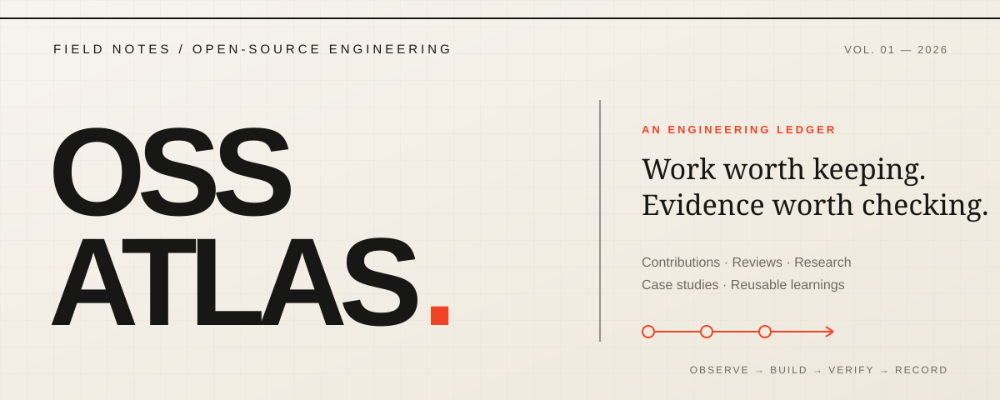

<p align="center">
  
</p>

<p align="center">
  <a href="https://github.com/aspire488/oss-atlas/actions/workflows/ci.yml"></a>
  <a href="https://github.com/aspire488/oss-atlas/actions/workflows/atlas-audit.yml"></a>
  
</p>

<p align="center">
  <strong>AN OPEN-SOURCE ENGINEERING JOURNAL</strong><br>
  <sub>Contributions, investigations, reviews, and the engineering lessons behind them.</sub>
</p>

<br>

## 00 — The ledger

OSS Atlas is a living, evidence-first record of engineering work across external open-source projects.

It follows work beyond the commit: the original problem, implementation, regression coverage, maintainer feedback, upstream outcome, and what can be learned from it. It records unsuccessful attempts with the same factual discipline as merged work.

### Contribution dashboard

<table>
  <tr>
    <th colspan="4" align="left">AUTHORED UPSTREAM PULL REQUESTS</th>
  </tr>
  <tr>
    <td align="center" width="25%"><sub>TOTAL</sub><br><strong><samp>69</samp></strong></td>
    <td align="center" width="25%"><sub>MERGED</sub><br><strong><samp>15</samp></strong></td>
    <td align="center" width="25%"><sub>OPEN</sub><br><strong><samp>27</samp></strong></td>
    <td align="center" width="25%"><sub>CLOSED</sub><br><strong><samp>27</samp></strong></td>
  </tr>
  <tr>
    <td colspan="4"><sub>Snapshot: 19 November 2026 · Personal-fork PRs excluded · Counts sourced from the canonical PR ledger</sub></td>
  </tr>
</table>

<table>
  <tr>
    <th colspan="2" align="left">OTHER EXTERNAL CONTRIBUTIONS · 28 NOVEMBER 2026</th>
  </tr>
  <tr>
    <td width="38%"><strong>Technical evaluation</strong></td>
    <td>Reader-1 API QA completed; structured findings delivered to XERJ</td>
  </tr>
  <tr>
    <td><strong>Patch submitted for review</strong></td>
    <td>OpenAI Agents Python SDK #4864 · support handoff; upstream acceptance not confirmed</td>
  </tr>
  <tr>
    <td><strong>External adoption</strong></td>
    <td>Pipo 3D-world selected and published by XERJ Corpus Hub with attribution</td>
  </tr>
  <tr>
    <td><strong>Research participation</strong></td>
    <td>Beihang University OSS and generative-AI survey submitted</td>
  </tr>
</table>

<p align="center"><sub>Separate ledgers, separate definitions: non-PR engagements never inflate authored-PR totals. Active evaluations and proposals are documented separately and are not counted as completed work.</sub></p>

---

## 01 — Selected work

<sub>A FEW UPSTREAM OUTCOMES · THE FULL RECORD IS LINKED BELOW</sub>

<table>
  <tr>
    <td width="50%" valign="top">
      <strong>MICROSOFT / PyRIT</strong><br>
      <sub>AI RED-TEAMING FRAMEWORK</sub>
      <br><br>
      <a href="https://github.com/microsoft/PyRIT/pull/2762">Dataset Summary API</a><br>
      <a href="https://github.com/microsoft/PyRIT/pull/2823">HarmBench context preservation</a><br>
      <a href="https://github.com/microsoft/PyRIT/pull/2882">ExactTextMatching empty-target fix</a><br>
      <a href="https://github.com/microsoft/PyRIT/pull/2976">StringJoinConverter identifier fix</a><br>
      <a href="https://github.com/microsoft/PyRIT/pull/3429">XXE XInclude resource detection</a><br>
      <a href="https://github.com/microsoft/PyRIT/pull/3885">Failed media download handling</a>
      <br><br>
      <sub>6 FEATURED MERGED CONTRIBUTIONS</sub>
    </td>
    <td width="50%" valign="top">
      <strong>OTHER PROJECTS</strong><br>
      <sub>TOOLS · SYSTEMS · DEVELOPER EXPERIENCE</sub>
      <br><br>
      <a href="https://github.com/RajX-dev/N3MO/pull/39">N3MO — Ruby/Kotlin routing regression coverage</a><br>
      <a href="https://github.com/eumemic/aios/pull/2457">aios — streaming termination semantics</a><br>
      <a href="https://github.com/eumemic/aios/pull/2460">aios — LiteLLM parameter translation</a><br>
      <a href="https://github.com/0xarchit/github-profile-analyzer/pull/30">Profile Analyzer — evidence-weighted impact</a><br>
      <a href="https://github.com/PicadoLabs/agent-bench/pull/8">Agent-Bench — global command palette</a>
      <br><br>
      <sub>SELECTED CROSS-PROJECT WORK</sub>
    </td>
  </tr>
</table>

<p align="right"><a href="contributions/INDEX.md"><strong>OPEN THE CONTRIBUTION INDEX ↗</strong></a></p>

---

## 02 — Explore the archive

<table>
  <tr>
    <td width="50%" valign="top">
      <sub>01 / CONTRIBUTIONS</sub>
      <h3>What shipped. What didn't.</h3>
      The complete lifecycle of authored external OSS work.
      <br><br>
      → <a href="contributions/INDEX.md">Curated index</a><br>
      → <a href="contributions/ALL_PR_HISTORY.md">Complete PR history</a><br>
      → <a href="data/contributions.json">Machine-readable ledger</a>
    </td>
    <td width="50%" valign="top">
      <sub>02 / INVESTIGATION</sub>
      <h3>Reasoning behind the work.</h3>
      Issue analysis, technical notes, reviewer feedback, and deep dives.
      <br><br>
      → <a href="research/README.md">Research library</a><br>
      → <a href="research/2026-11-28-non-pr-external-work.md">Non-PR external work ledger</a><br>
      → <a href="case-studies/README.md">Case studies</a><br>
      → <a href="learnings/README.md">Engineering learnings</a>
    </td>
  </tr>
  <tr>
    <td width="50%" valign="top">
      <sub>03 / EVIDENCE</sub>
      <h3>Claims with receipts.</h3>
      Structured evidence and the rules used to interpret it.
      <br><br>
      → <a href="data/skills.json">Evidence-derived skill map</a><br>
      → <a href="data/reviews.json">Review metadata</a><br>
      → <a href="docs/OPERATING_MODEL.md">Operating model</a>
    </td>
    <td width="50%" valign="top">
      <sub>04 / INFRASTRUCTURE</sub>
      <h3>A ledger that checks itself.</h3>
      Validation, drift detection, and the system that maintains the archive.
      <br><br>
      → <a href="docs/AUTOMATION.md">Automation contract</a><br>
      → <a href="docs/ROADMAP.md">Roadmap</a><br>
      → <a href=".github/workflows/ci.yml">CI workflow</a>
    </td>
  </tr>
</table>

---

## 03 — The method

```text
  UPSTREAM ISSUE / DISCUSSION
             │
             ▼
       INVESTIGATION
             │
             ▼
      IMPLEMENTATION
             │
             ▼
    TESTS & VERIFICATION
             │
             ▼
     MAINTAINER REVIEW
             │
             ▼
      UPSTREAM OUTCOME
             │
             ▼
     CASE STUDY / LEARNING
```

The canonical source is `data/contributions.json`. GitHub Actions checks repository structure, metadata consistency, internal links, and contribution-state drift.

### Editorial rules

- **Evidence over assertion.** Upstream GitHub state determines contribution status.
- **Precision over theatre.** Test claims state exactly what ran; no targeted test is dressed up as a full-suite pass.
- **Clean boundaries.** Personal-fork proposals never inflate external OSS totals.
- **History over vanity.** Closed and superseded work remains visible.
- **No invented impact scores.** The ledger records verifiable activity, not subjective rankings.

---

<p align="center">
  <strong>OBSERVE → BUILD → VERIFY → DOCUMENT</strong><br><br>
  <sub>Maintained by <a href="https://github.com/aspire488">aspire488</a></sub><br>
  <sub><a href="contributions/INDEX.md">CONTRIBUTIONS</a> &nbsp;·&nbsp; <a href="research/README.md">RESEARCH</a> &nbsp;·&nbsp; <a href="docs/OPERATING_MODEL.md">METHOD</a></sub>
</p>