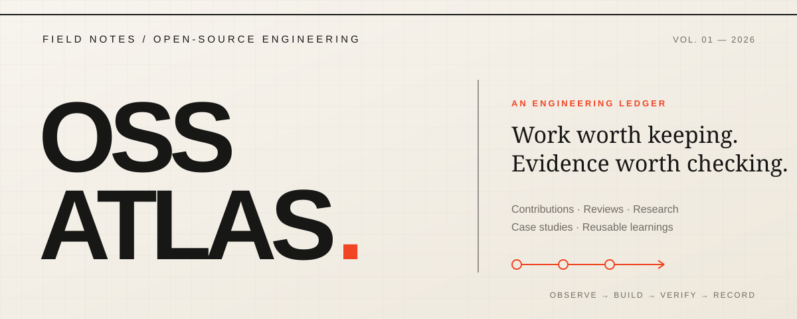
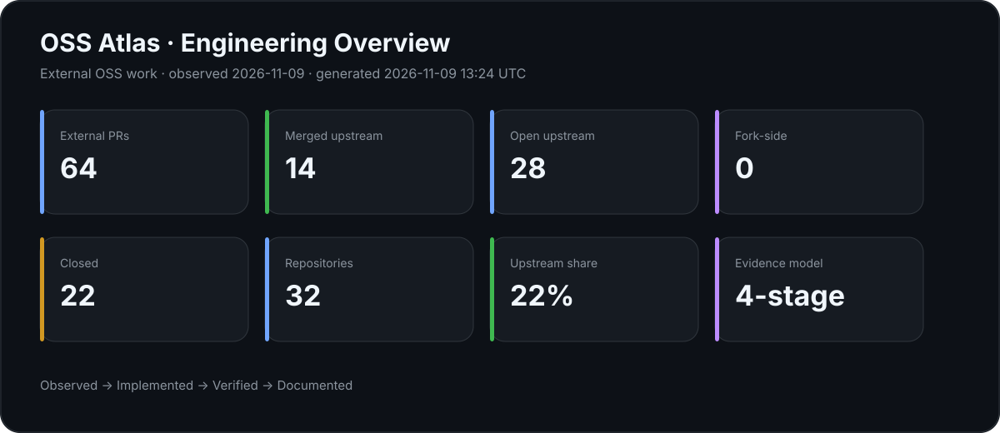

<!--
  OSS ATLAS
  A factual, evidence-first record of external open-source engineering.
-->

<p align="center">
  
</p>

<p align="center">
  <a href="https://github.com/aspire488/oss-atlas/actions/workflows/ci.yml"></a>
  <a href="https://github.com/aspire488/oss-atlas/actions/workflows/atlas-audit.yml"></a>
  <a href="https://github.com/aspire488/oss-atlas/blob/main/docs/OPERATING_MODEL.md"></a>
</p>

<p align="center">
  <strong>Open-source engineering, recorded with evidence.</strong><br>
  <sub>A living archive of contributions, technical investigations, maintainer feedback, and lessons that survive the pull request.</sub>
</p>

---

## The ledger

OSS Atlas is a structured record of work contributed to **external open-source projects**. It tracks the full lifecycle — from investigation and implementation through review, acceptance, rejection, and follow-up.

This is not a wall of green contribution badges. Every status has a source. Every validation claim has a boundary. Closed work stays in the history.

|  | Merged upstream | Open upstream | Closed, not merged | Total |
|:--|--:|--:|--:|--:|
| **Tracked PRs** | **14** | **22** | **19** | **55** |

<sub>Snapshot: 3 November 2026 · Fork-only work is kept separate and excluded from these external totals.</sub>

<p align="center">
  
</p>

## Selected work

A small selection of upstream outcomes and active engineering threads. The index and archive contain the complete record.

| Project | Work | Outcome |
|:--|:--|:--|
| [Microsoft PyRIT](https://github.com/microsoft/PyRIT) | [Dataset Summary API · #2762](https://github.com/microsoft/PyRIT/pull/2762) | <strong>MERGED</strong> |
| [Microsoft PyRIT](https://github.com/microsoft/PyRIT) | [HarmBench context preservation · #2823](https://github.com/microsoft/PyRIT/pull/2823) | <strong>MERGED</strong> |
| [Microsoft PyRIT](https://github.com/microsoft/PyRIT) | [ExactTextMatching empty-target fix · #2882](https://github.com/microsoft/PyRIT/pull/2882) | <strong>MERGED</strong> |
| [Microsoft PyRIT](https://github.com/microsoft/PyRIT) | [StringJoinConverter identifier fix · #2976](https://github.com/microsoft/PyRIT/pull/2976) | <strong>MERGED</strong> |
| [Microsoft PyRIT](https://github.com/microsoft/PyRIT) | [XInclude resource detection · #3429](https://github.com/microsoft/PyRIT/pull/3429) | <strong>MERGED</strong> |
| [RajX-dev/N3MO](https://github.com/RajX-dev/N3MO) | [Ruby/Kotlin routing regression coverage · #39](https://github.com/RajX-dev/N3MO/pull/39) | <strong>MERGED</strong> |
| [Microsoft PyRIT](https://github.com/microsoft/PyRIT) | [Reject failed media downloads · #3885](https://github.com/microsoft/PyRIT/pull/3885) | <strong>OPEN</strong> |

<p align="right"><a href="contributions/INDEX.md">Explore the full contribution index →</a></p>

## Explore the Atlas

<table>
  <tr>
    <td width="50%" valign="top">
      <h3>01 / Contributions</h3>
      <p>What changed, where it landed, and what happened next.</p>
      <ul>
        <li><a href="contributions/INDEX.md">Curated contribution index</a></li>
        <li><a href="contributions/ALL_PR_HISTORY.md">Complete PR history</a></li>
        <li><a href="data/contributions.json">Canonical JSON ledger</a></li>
      </ul>
    </td>
    <td width="50%" valign="top">
      <h3>02 / Research</h3>
      <p>Technical investigations and review context behind the work.</p>
      <ul>
        <li><a href="research/README.md">Research library</a></li>
        <li><a href="case-studies/README.md">Engineering case studies</a></li>
        <li><a href="learnings/README.md">Reusable learnings</a></li>
      </ul>
    </td>
  </tr>
  <tr>
    <td width="50%" valign="top">
      <h3>03 / Evidence</h3>
      <p>Structured metadata and explicit standards for claims.</p>
      <ul>
        <li><a href="data/skills.json">Evidence-derived skills</a></li>
        <li><a href="docs/OPERATING_MODEL.md">Operating model</a></li>
        <li><a href="docs/AUTOMATION.md">Automation contract</a></li>
      </ul>
    </td>
    <td width="50%" valign="top">
      <h3>04 / System</h3>
      <p>How the Atlas is validated, audited, and maintained.</p>
      <ul>
        <li><a href="docs/ROADMAP.md">Roadmap</a></li>
        <li><a href=".github/workflows/ci.yml">Continuous integration</a></li>
        <li><a href=".github/workflows/atlas-audit.yml">Scheduled ledger audit</a></li>
      </ul>
    </td>
  </tr>
</table>

## How the record is built

```text
  UPSTREAM EVIDENCE
        │
        ▼
  CONTRIBUTION RECORD ────────┐
        │                     │
        ▼                     ▼
  REVIEW & VALIDATION     STATUS HISTORY
        │                     │
        └──────────┬──────────┘
                   ▼
            CASE STUDY
                   │
                   ▼
          REUSABLE LEARNING
                   │
                   ▼
           SEARCHABLE LEDGER
```

The machine-readable source of truth is `data/contributions.json`. GitHub Actions validates the repository, audits recorded PR states, and regenerates the dashboard.

## The rules

- **Upstream evidence wins.** A merge is recorded only when the upstream repository confirms it.
- **Validation is scoped.** A targeted test is never presented as a full-suite pass.
- **Fork work stays distinct.** Personal-fork proposals are labelled and excluded from external contribution totals.
- **History is preserved.** Closed, superseded, and rejected work remains part of the engineering record.
- **No vanity arithmetic.** Counts describe tracked activity, not quality or impact.

The full standard lives in the [Operating Model](docs/OPERATING_MODEL.md).

---

<p align="center">
  <sub>Maintained by <a href="https://github.com/aspire488">aspire488</a> · Built to be audited, not admired at a glance.</sub><br>
  <sub><a href="contributions/INDEX.md">Contributions</a> · <a href="research/README.md">Research</a> · <a href="docs/OPERATING_MODEL.md">Method</a></sub>
</p>
